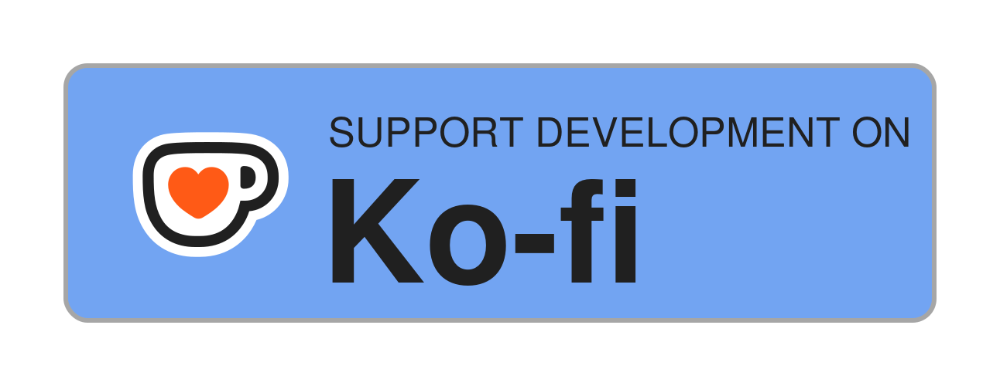
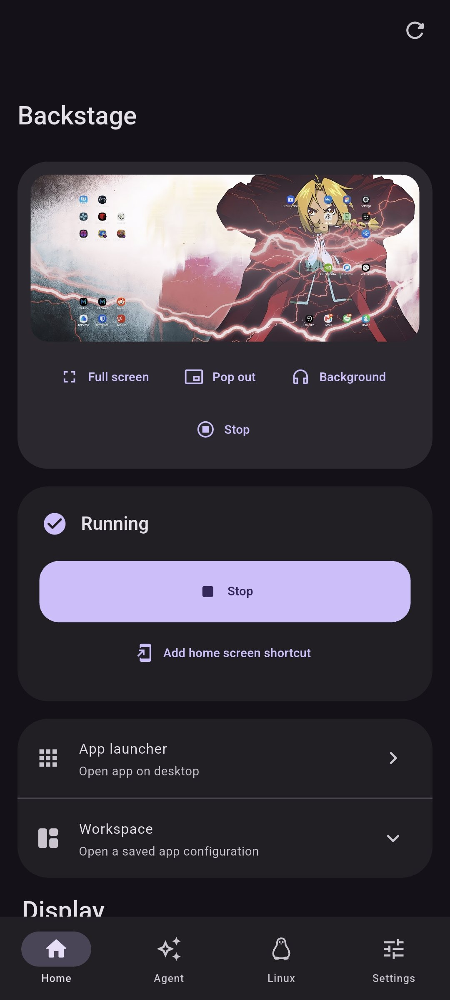
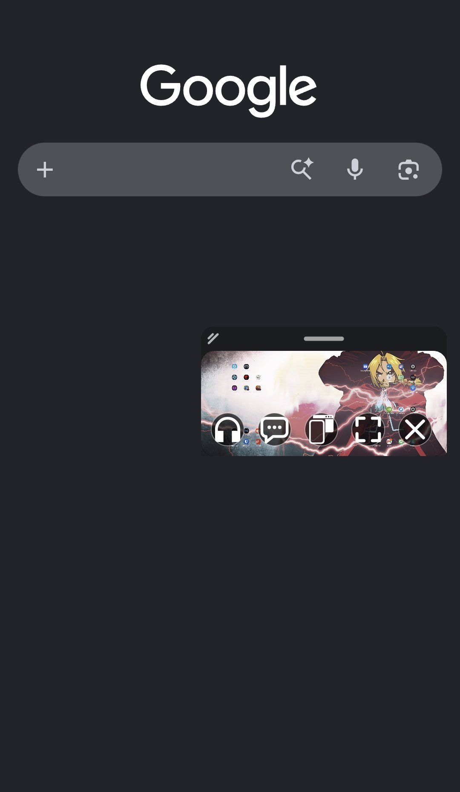
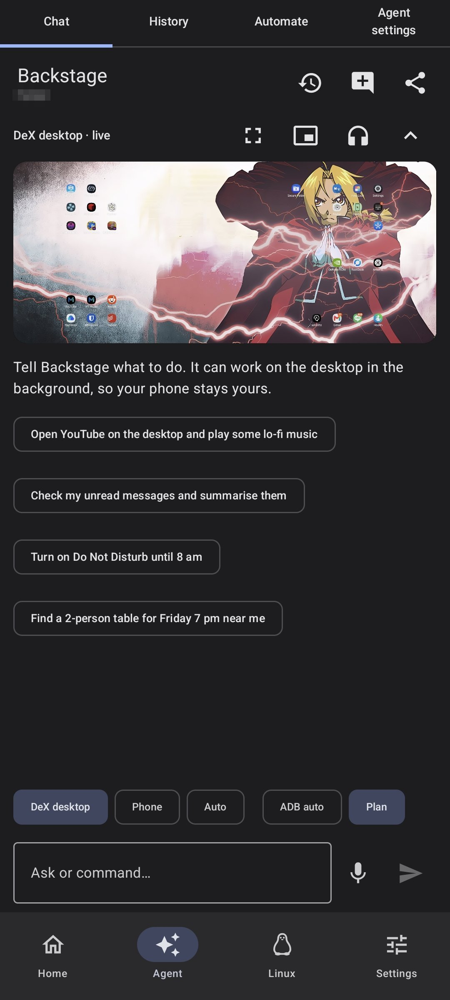
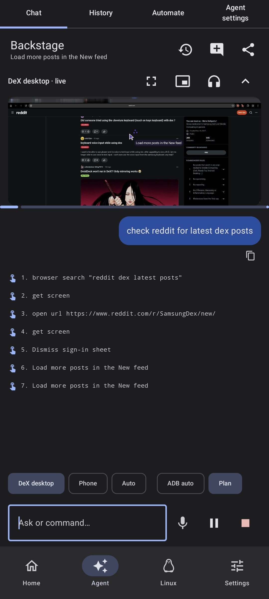
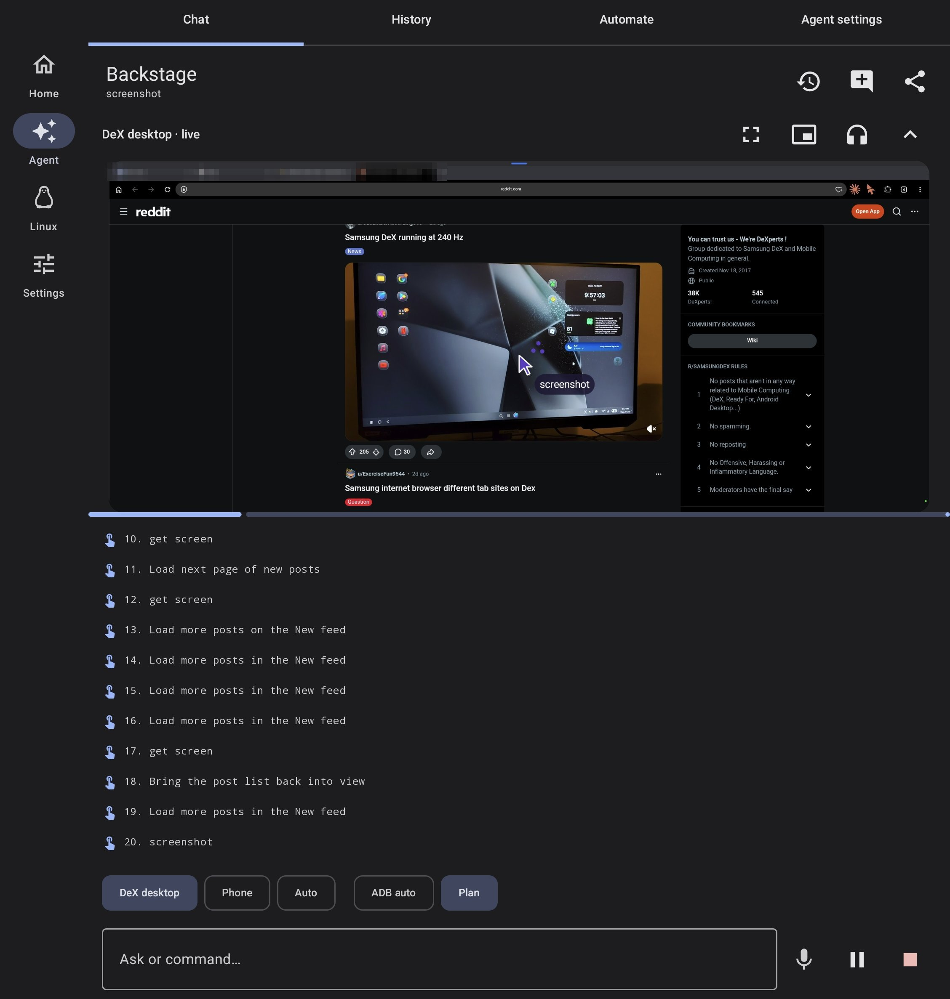
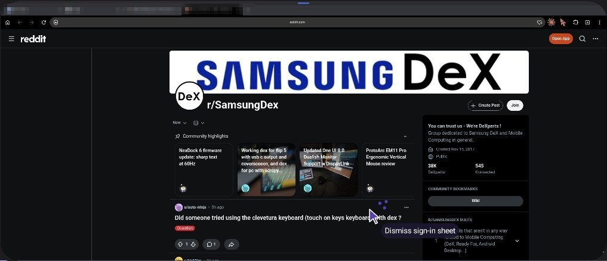

# Backstage

Run an AI agent in the background on Android, on its own virtual desktop, while you use your phone.

---

Backstage runs a full desktop ([Dextop](https://github.com/NarYuki/Dextop)) on your phone and an AI agent that
operates its apps for you, in the background, with your own model and keys.

## Screenshots

<table>
  <tr>
    <th>Backstage app</th><th>Background popup</th><th>In-app chat</th><th>In-app agent work</th>
  </tr>
  <tr>
    <td></td>
    <td></td>
    <td></td>
    <td></td>
  </tr>
  <tr>
    <th colspan="2">In-app, unfolded view</th><th colspan="2">Backstage in action</th>
  </tr>
  <tr>
    <td colspan="2"></td>
    <td colspan="2"></td>
  </tr>
</table>

## Features

- **Fork of Dextop**: all [Dextop](https://github.com/NarYuki/Dextop) features, with an AI agent built in.
- **Desktop and phone**: the agent works on the virtual desktop in the background or on the phone screen; commands
  such as "open Maps on the desktop" or "launch WhatsApp on the phone" pick the right screen.
- **Fast native control**: precise taps, long presses, swipes, scrolling and right-clicks, app launching, and ADB
  shell access, so the agent can also install and remove apps.
- **System instructions**: standing instructions the agent follows in every task.
- **MCP**: connect remote MCP servers as extra tools.
- **Skills**: add skills by hand or sync them from a GitHub repository.
- **Same setup in Termux**: Backstage ships the [omp](https://github.com/can1357/oh-my-pi) coding agent. Pair Termux
  once, type `omp`, and it uses the same AI provider and key as Backstage, no second setup. The Backstage agent can
  also hand coding tasks to omp itself.

## Installation

Android 13+, arm64.

1. Allow installing apps from outside the Play Store
   ([Android: install unknown apps](https://developer.android.com/distribute/marketing-tools/alternative-distribution#unknown-sources)).
2. Download the APK from the [latest release](https://github.com/TheEggmanEmpire/Backstage/releases/latest).
3. Install and start [Stellar](https://github.com/roro2239/Stellar), or alternatively
   [Shizuku Plus](https://github.com/thejaustin/ShizukuPlus).
4. Open Backstage and grant it access in Stellar (or Shizuku Plus).
5. In Settings → AI provider, set an OpenAI-compatible server (base URL and API key) or sign in with ChatGPT
   (paid plan).
6. Give the agent tasks in the Backstage app or from its notification.
7. Optional: add skills, instructions and MCP servers for the agent.

## Compatibility

| Environment | Status | Notes |
|---|---|---|
| Samsung DeX, One UI 8+ | Fully supported | Most complete environment; DeX-managed features use Samsung's implementation. |
| Samsung DeX, before One UI 8 | Limited, likely incompatible | Older DeX may lack the required display and window management. |
| Google Pixel | Limited | Depends on Android's freeform/desktop mode and hidden API access; some features may not work. |
| OPPO ColorOS desktop | Limited | The desktop shows, but system parts such as the taskbar may be missing. |
| Xiaomi HyperOS and MIUI | Not supported | Disabled. |
| Other Android devices | Experimental | Virtual display, mirroring and freeform support vary by maker, model and OS version. |

For the virtual desktop, Backstage follows the [Dextop](https://github.com/NarYuki/Dextop) upstream releases.

**Tested devices**

| Device | Status |
|---|---|
| Samsung Galaxy Z Fold8 | Fully supported |

## Feedback

Found a problem? [Open an issue](https://github.com/TheEggmanEmpire/Backstage/issues).
[Pull requests](https://github.com/TheEggmanEmpire/Backstage/pulls) are welcome and are reviewed before merging.

## More

[Changelog](CHANGELOG.md) ·
License GPL-3.0-or-later, a modified [Dextop](NOTICE.md)
